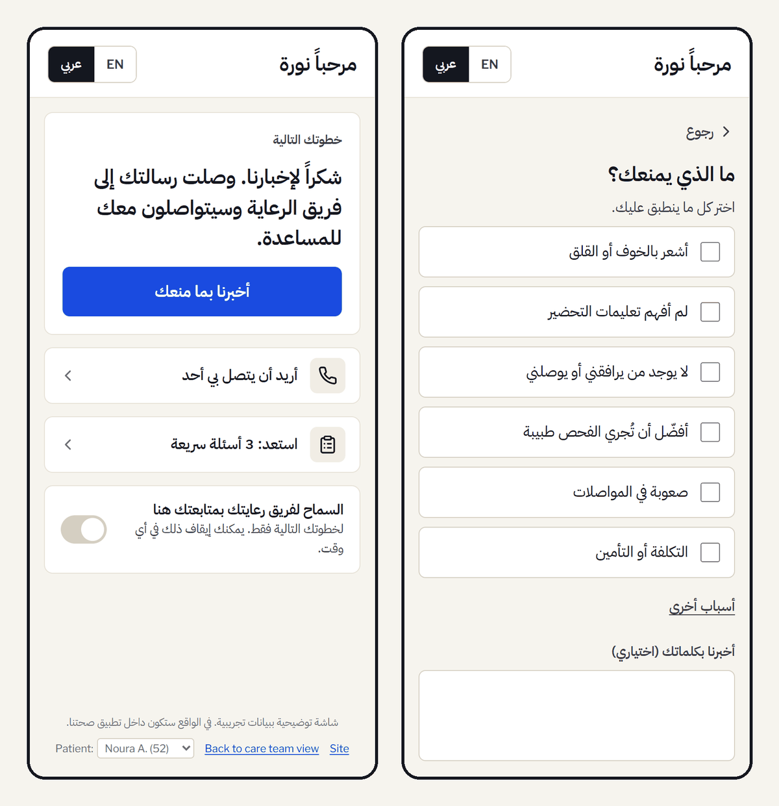
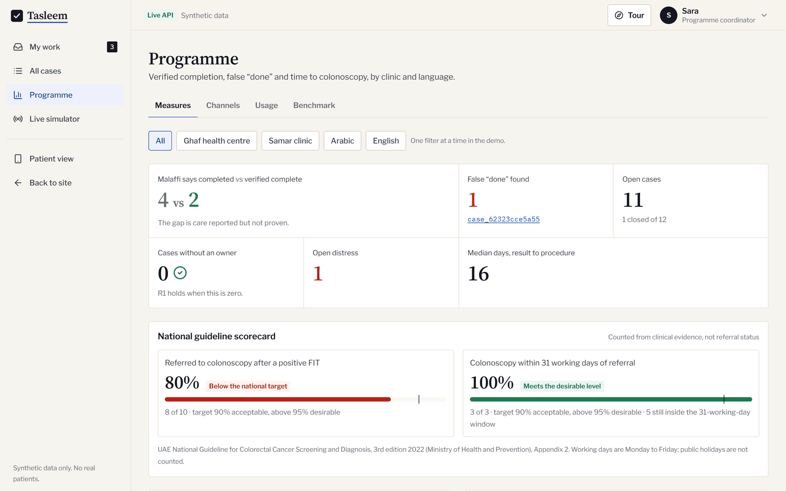
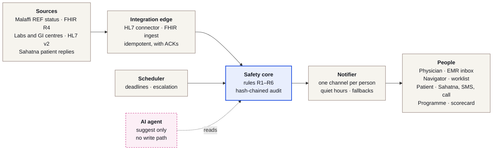
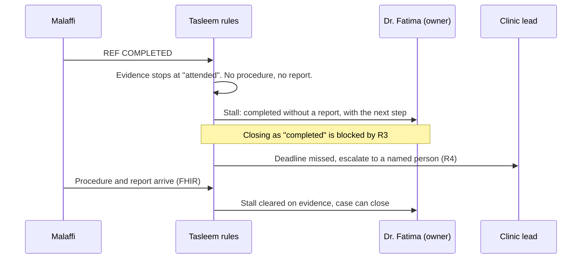

<div align="center">

# ✓ Tasleem

### Know whether the care *actually* happened.

Malaffi tells you a referral exists. Tasleem tells you whether the colonoscopy really happened, why not, and who is fixing it.

[](https://github.com/sankalp2515/screening-to-care/actions/workflows/ci.yml)
[](https://tasleem.swedencentral.cloudapp.azure.com)


**[Live demo](https://tasleem.swedencentral.cloudapp.azure.com)** ·
**[Guided tour](https://tasleem.swedencentral.cloudapp.azure.com/demo?tour=1)** ·
[How it works](#how-it-works) ·
[Proof](#proof-you-can-rerun) ·
[Run it](#run-it-in-two-minutes) ·
[Roadmap](docs/ROADMAP.md)

<sub>Future Health Digital Innovation Challenge 2026 · Population Health · Challenge 05 "Closing the Screening-to-Care Loop"</sub>

<br/>

<a href="https://tasleem.swedencentral.cloudapp.azure.com"></a>

</div>

## The problem

A positive stool test (FIT) only saves a life if a colonoscopy follows. In Abu Dhabi, that loop breaks quietly.

| | Abu Dhabi clinics, SEHA, 2015–16 ([BMC Cancer 2021](https://link.springer.com/article/10.1186/s12885-021-08623-9)) |
|---|---|
| **30.5%** | of positive stool tests were followed by a colonoscopy. **933 people were not.** |
| **36%** | of those 933 were referred, then missed the specialist appointment. |
| **About 24** | cancers would be expected among them, at the rate found in the people who did have a colonoscopy (11 in 436). |

Since DoH Circular 210/2026, every referral flows through Malaffi as an HL7 REF message, so everyone can *see* a referral. But a status is not a colonoscopy. A referral can say **COMPLETED** after a clinic visit, while no procedure and no report ever happened. Nobody notices, because everyone trusts the status.

**Tasleem** sits beside Malaffi and Sahatna. It checks each referral against clinical evidence, gives every case one named owner, escalates stalls to named people, and keeps the case open until the report is back and the patient is told.

## See it in 60 seconds

No sign-up. Every patient is synthetic. Pick a role, or take the guided tour (seven steps, about three minutes).

| Role | Open as | What you will see |
|---|---|---|
| 🩺 Family physician | [Dr. Fatima](https://tasleem.swedencentral.cloudapp.azure.com/demo?tour=1) | Rajesh's false "completed", the reported versus verified gap, closure blocked by rule R3 |
| 🧭 Care navigator | Aisha, in the [role picker](https://tasleem.swedencentral.cloudapp.azure.com/demo) | Noura's barrier in her own words, an AI suggestion she confirms, a playbook task |
| 📱 Patient | Noura, in the role picker | Her next step in Arabic, no results by message, "call me" one tap away |
| 📊 Programme lead | Sara, in the role picker | Verified completion versus Malaffi status, and the UAE national guideline scorecard |

> Changed something? **Reset demo** on the role picker puts every case back for everyone.

## What it does

<table>
<tr>
<td width="50%" valign="top">

**One list, one owner, one next step**

The family physician sees only stalled cases, worst first, each with the reason, the evidence and a named owner. Missed deadlines climb a ladder of named people: owner, clinic lead, programme coordinator.

</td>
<td width="50%"></td>
</tr>
<tr>
<td width="50%"></td>
<td width="50%" valign="top">

**Reported versus verified**

The moment that matters. Malaffi says COMPLETED; the evidence stops at "attended". Tasleem names the gap, names the person who acts, and refuses to close the case without the report or a signed clinical decision. The AI brief on the right only drafts, and every sentence cites an event.

</td>
</tr>
<tr>
<td width="50%" valign="top">

**A patient companion people actually use**

One next step, one big button, Arabic and English with right-to-left layout. Patients say what got in the way in one tap, including **"I would prefer a female doctor"**, a barrier the Abu Dhabi study names. Messages never contain results (IFHAS 4.9.2.3), and a policy check blocks anyone who tries.

</td>
<td width="50%"></td>
</tr>
<tr>
<td width="50%"></td>
<td width="50%" valign="top">

**Measured against the national guideline**

The programme view counts care from clinical evidence, never from status. It scores every clinic against the UAE National Guideline for Colorectal Cancer Screening (2022): at least 90% referred after a positive FIT, and colonoscopy within 31 working days of referral.

</td>
</tr>
<tr>
<td width="50%" valign="top">

**Send real events, watch it react**

A live simulator replays Malaffi, lab and Sahatna events through the real rules: a false "completed", the report arriving, a missed colonoscopy, a patient who mentions bleeding, a patient no channel can reach. HL7 v2 messages go through the connector and come back with ACKs.

</td>
<td width="50%"></td>
</tr>
</table>

## How it works



How Rajesh's false "completed" is caught:



**Rules decide, AI only drafts.** Every decision, score and timer is deterministic code. The AI agent writes cited case briefs and policy-checked patient drafts; a person confirms or sends. It has no write access to clinical state.

### Six safety rules, enforced in code

| | Rule | Enforced in | Tested by |
|---|---|---|---|
| **R1** | An open case always has exactly one named owner | `domain/engine.py` | `test_invariants.py`: 2,000 random command sequences |
| **R2** | Handoff is two-step; the sender owns the case until the receiver accepts | `domain/engine.py` | `test_engine.py`, `test_api.py` |
| **R3** | A case closes only with an allowed outcome plus evidence or a signed clinician decision | `domain/engine.py` | `test_engine.py`, `test_api.py` |
| **R4** | Every missed deadline escalates to a named human | `domain/checks.py`, scheduler | `test_engine.py`: the escalation ladder is named and capped |
| **R5** | AI never closes, prioritises, changes a plan or advises | agent has no write path | `test_agent.py` |
| **R6** | Every state change is an event in a hash-chained, tamper-evident log | `domain/audit.py` | `test_barriers_audit.py` |

### Services

| Service | Port | Role |
|---|---|---|
| `tasleem` case-core API | 8000 | The only writer of clinical state: rules, audit chain, inboxes, outbox |
| scheduler | none | Deadlines and escalations, as its own process |
| `tasleem_notifier` | 8010 | Each person on their own channel: Sahatna, content-free SMS, EMR inbox, worklist, digest; quiet hours and fallbacks |
| `tasleem_agent` | 8020 | Suggest-only AI on Azure OpenAI: cited briefs, policy-checked drafts |
| `tasleem_connector` | 8030 | HL7 v2 ORU, REF and SIU from labs, GI centres and Malaffi, mapped to FHIR, with ACKs |
| web | 8080 | React app and gateway: staff console, patient companion, landing page |

Design detail: [architecture](docs/architecture/ARCHITECTURE.md), [why the safety core is one service (ADR-001)](docs/architecture/ADR-001-service-boundaries.md), [user journeys](docs/product/USER_JOURNEYS.md), [workflow and integration](docs/product/WORKFLOW_AND_INTEGRATION.md), [OpenAPI contracts](docs/api/).

## Proof you can rerun

Software results on synthetic data, not patient outcomes. A clinical pilot measures those.

| Claim | Result | Rerun it |
|---|---|---|
| Stalled journeys that reach a named person | **99.9%** vs 81.8% for Malaffi status only | `python -m tasleem.bench.reality` · [report](docs/evidence/REAL_WORLD_FIT.md) |
| Median days from care stopping to an alert | **1.9** vs 16.5 | same run, 2,000 patients, failure mix from Martin 2017 |
| Journeys wrongly counted as done | **0** vs 160 | same run |
| Labelled hard cases (missing, wrong, out-of-order, distress) | **64 of 67**, misses kept in the table | `python -m tasleem.bench.hardcases` · [cases](docs/evidence/HARD_CASES.md) |
| Automated tests | **241** backend, **24** web | `pytest` · `npm test` |
| End-to-end checks on the live Azure stack | **32 of 32** | `python -m tasleem.smoke --stack` |
| AI users with jobs to be done | **42 of 42** checks | [persona simulation](docs/evidence/PERSONA_SIMULATION.md) |
| Scale on PostgreSQL | 5,000 patients at **51.8 messages/s**, about 1,000× Abu Dhabi's average load | `python -m tasleem.loadtest` · [scale](docs/evidence/SCALE_POSTGRES.md) |

Every test case, with input, expected, actual and component, is in [TEST_CASES.md](docs/evidence/TEST_CASES.md). The three demo-path bugs found while walking the live site on 19 Nov are there too.

## Run it in two minutes

Everything on Docker: web app, API, scheduler, notifier, agent, connector, PostgreSQL and Redis.

```bash
git clone https://github.com/sankalp2515/screening-to-care.git
cd screening-to-care
docker compose up -d --build --wait
```

Open **http://localhost:8080**, then check every service end to end:

```bash
cd backend && python -m tasleem.smoke --stack
```

<details>
<summary><b>Backend only, for development</b></summary>

```bash
cd backend
pip install -c constraints.txt -e ".[dev]"
python -m pytest -q
TASLEEM_DEMO_MODE=true TASLEEM_SEED_ON_START=true uvicorn tasleem.api.app:app --reload
```

Open http://localhost:8000/docs. Demo mode is **off by default**. With it on, send `X-Demo-User: dr-fatima` (or any id from `GET /v1/directory/people`). The other services run the same way (`uvicorn tasleem_notifier.app:app --port 8010`, and likewise `tasleem_agent` and `tasleem_connector`), each with `<PREFIX>_DEMO_MODE=true`. Every setting is in [backend/.env.example](backend/.env.example).

</details>

<details>
<summary><b>Web app only</b></summary>

```bash
cd frontend
npm ci
npm run dev        # replays a recorded demo bundle, no backend needed
npm test && npm run build
```

Set `VITE_API_BASE_URL` to point it at a running backend.

</details>

<details>
<summary><b>Evidence commands</b></summary>

| Command | What it does |
|---|---|
| `python -m tasleem.bench` | Three-arm benchmark: reminders only, Malaffi status only, Tasleem |
| `python -m tasleem.bench.reality` | 2,000-patient cohort with a published failure mix |
| `python -m tasleem.bench.hardcases` | 67 labelled hard cases |
| `python -m tasleem.loadtest --patients 5000` | Scale run |
| `python -m tasleem.migrate` | Database migrations |

</details>

## Built for Abu Dhabi

| Standard or rule | How Tasleem meets it |
|---|---|
| DoH Circular 210/2026 (referrals through Malaffi) | Reads Malaffi REF events; never builds a second referral exchange |
| IFHAS 4.9.2.3 (abnormal results discussed in person) | Patient messages never carry results; a policy check refuses them |
| UAE CRC screening guideline, 3rd edition 2022 | Live scorecard of its 90% referral and 31-working-day targets |
| UAE Federal Law No. 2 of 2019 (health data stays in the UAE) | Pilot hosting in Azure UAE North; the demo runs in Sweden Central on synthetic data only |
| FHIR R4, HL7 v2, SNOMED CT, LOINC | Used at every edge; pathways are versioned YAML a clinical lead can review |
| Responsible AI | Suggest-only agent; every AI sentence labelled and cited; AI and rules visibly separated on screen |

Security posture and open items: [security audit](docs/engineering/SECURITY_AUDIT.md) · [failure modes](docs/engineering/FAILURE_MODES.md) · [operations](docs/engineering/OPERATIONS.md) · [testing strategy](docs/engineering/TESTING_STRATEGY.md).

## Repository map

```text
backend/
  tasleem/              case-core API, rules engine (domain/), scheduler, benchmarks (bench/), smoke test
  tasleem_notifier/     channels, quiet hours, fallbacks, receipts
  tasleem_agent/        suggest-only AI: briefs, drafts, barrier suggestions
  tasleem_connector/    HL7 v2 in, FHIR out, ACKs
  pathways/             clinician-reviewable YAML: FIT to colonoscopy, HbA1c, blood pressure
  tests/                241 tests: unit, API, invariants, security, end to end
frontend/               React 18, Vite, TypeScript, Tailwind: staff console, patient companion, landing
deploy/azure/           Azure VM, Caddy (HTTPS), Key Vault secrets, systemd unit
docs/                   product, architecture, engineering, evidence, API contracts, roadmap
```

## Roadmap

The prototype is honest about what is not built yet. Before a 90-day pilot: cover and delegation when an owner is away, an unmatched-patient review queue, a signed clinical safety case, a Malaffi sandbox feed, real Sahatna and SMS gateways, UAE Pass and Entra ID sign-in, UAE North hosting as code, and browser end-to-end tests of every persona. The full list, each item with a test for "done", is in **[docs/ROADMAP.md](docs/ROADMAP.md)**.

## Contributing, security and licence

- Read [CONTRIBUTING.md](CONTRIBUTING.md) before opening a pull request. Synthetic data only, and any change that weakens R1–R6 is rejected.
- Report a vulnerability privately as described in [SECURITY.md](SECURITY.md).
- **Licence:** not yet chosen. Until the team picks one before the pilot, all rights are reserved. Third-party components keep their own licences (MIT, BSD, Apache-2.0, LGPL for psycopg, PostgreSQL, SIL OFL fonts).

<div align="center">
<br/>
<sub>All patients, clinicians and clinics in this repository are fictional. Nothing here is medical advice.</sub>
</div>
