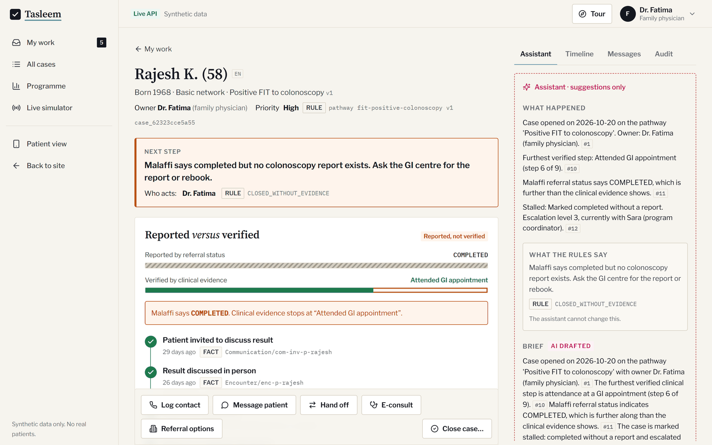
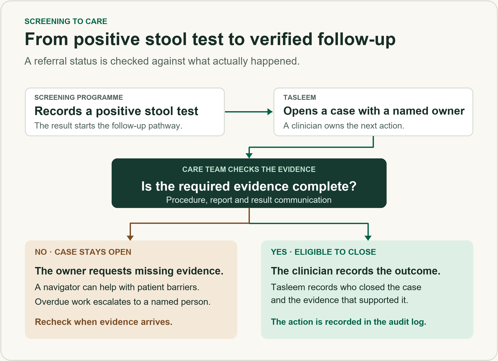
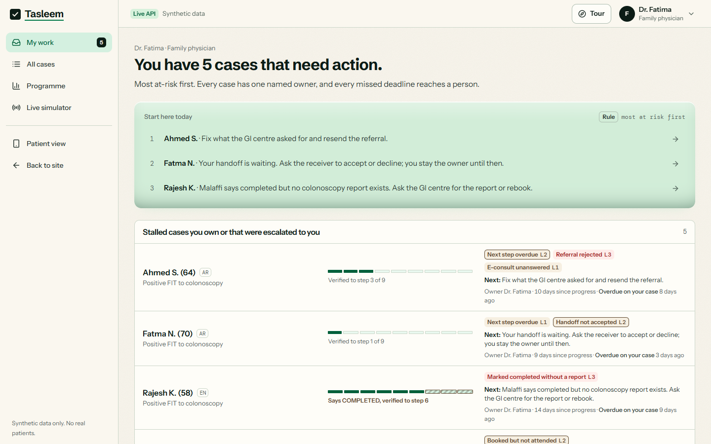
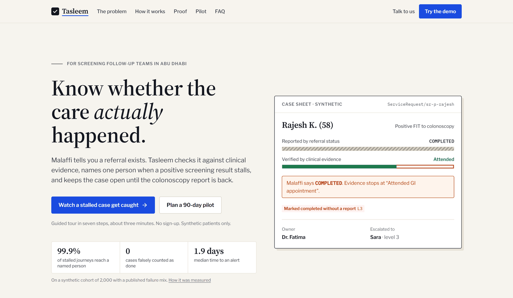
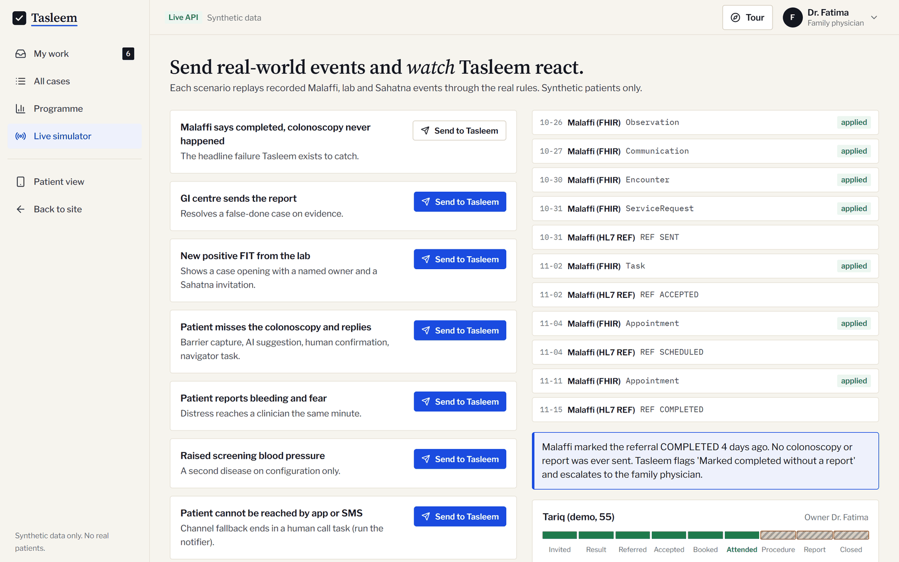
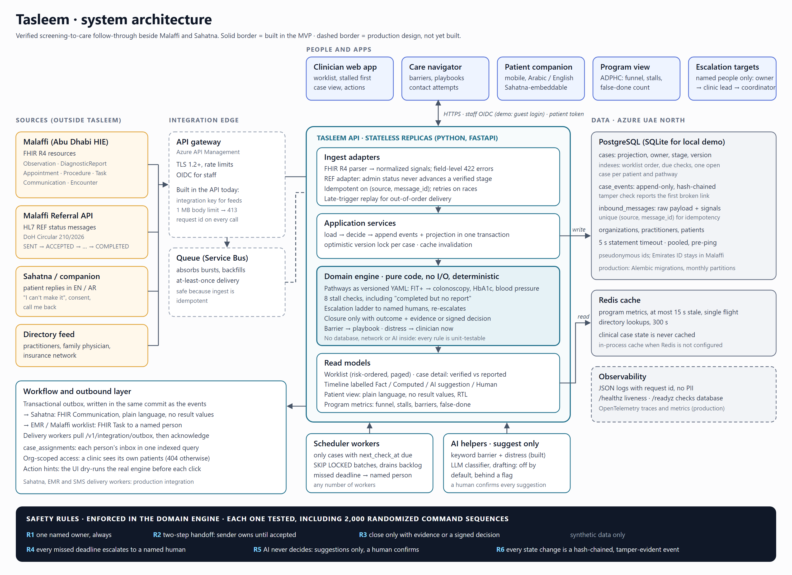
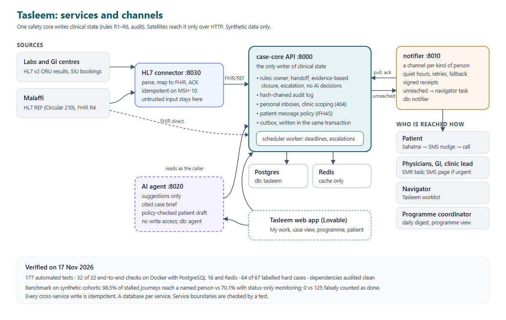

<div align="center">

# Tasleem

### Know whether follow-up care happened

Tasleem reconciles referral status with clinical evidence after a positive stool screening test. It flags the gap and names the clinician who acts next.

**[Open the guest tour](https://tasleem.swedencentral.cloudapp.azure.com/demo?tour=1)** · [Choose a demo role](https://tasleem.swedencentral.cloudapp.azure.com/demo) · [Technical documentation](#architecture-and-services) · [Evidence](#evidence) · [Run locally](#run-locally)

[](https://github.com/sankalp2515/screening-to-care/actions/workflows/ci.yml) [](#architecture-and-services) [](#demo-gallery)

<sub>Future Health Digital Innovation Challenge 2026 · Population Health · Challenge 05</sub>

</div>

[](https://tasleem.swedencentral.cloudapp.azure.com/demo?tour=1)

## A referral can be complete while the care is unverified

In the synthetic demo, Rajesh’s referral says **Completed**. His clinical record confirms a gastroenterology (GI) visit, and the colonoscopy is still unverified. Tasleem keeps the case open, names Dr. Fatima as the owner, and asks her to reconcile the missing report. Use **Close case…** in the tour to see the evidence requirement.

In a 2015–16 study at Abu Dhabi’s SEHA clinics, **30.5%** of Emirati adults aged 40–75 with a positive stool screening test underwent follow-up colonoscopy. [SEHA study](https://link.springer.com/article/10.1186/s12885-021-08623-9)

## User journey

[](docs/assets/readme/user-journey.png)

A handoff transfers ownership after the recipient accepts. Other closure outcomes still require their specified evidence or signed clinical decision. See [all user journeys](docs/product/USER_JOURNEYS.md) and the [integration workflow](docs/product/WORKFLOW_AND_INTEGRATION.md).

## Demo gallery

All roles use fictional patients. The hosted prototype runs with a live application API and simulated patient and partner events.

<table>
<tr><td width="70%" valign="top"><strong>Clinician worklist</strong><br/>Named owners, overdue cases and their next actions.<br/><br/></td>
<td width="30%" valign="top"><strong>Arabic patient companion</strong><br/>Patients can explain a barrier or request a callback.<br/><br/></td></tr>
</table>

<details>
<summary>Landing page, programme dashboard and event simulator</summary>

| Screen | Preview |
|---|---|
| Public site | [](https://tasleem.swedencentral.cloudapp.azure.com) |
| Programme |  |
| Event simulator |  |

</details>

## Architecture and services

The **case core** owns workflow state, the audit log and the outbox. The connector normalizes HL7 v2 and FHIR inputs. The scheduler handles deadlines, the notifier handles delivery, and the AI service offers evidence extraction and draft suggestions for human review.

[](docs/architecture/architecture.png)

The system diagram includes the proposed UAE North pilot environment and external integrations. The current Azure demo is in Sweden Central with synthetic data. [Architecture notes](docs/architecture/ARCHITECTURE.md)

[](docs/architecture/services.png)

The service diagram retains its 17 November snapshot labels and measurements. Current validation is listed under [Evidence](#evidence). [Service boundaries](docs/architecture/ADR-001-service-boundaries.md) · [OpenAPI contracts](docs/api/)

| Component | Responsibility |
|---|---|
| [Case core](backend/tasleem/) | Deterministic case rules, worklists and hash-chained audit history |
| [Scheduler](backend/tasleem/workers/) | Due checks and escalation deadlines |
| [HL7 connector](backend/tasleem_connector/) | ORU, REF and SIU ingestion with acknowledgements |
| [Notifier](backend/tasleem_notifier/) | Delivery routing, quiet hours, retries and fallbacks |
| [AI assistant](backend/tasleem_agent/) | Quoted report findings, reply suggestions and message drafts under human review |
| [Web app](frontend/) | Clinician worklist, navigator, programme console and bilingual patient companion |

### Safety rules

| Rule | Product behavior |
|---|---|
| R1 · Ownership | Every open case has exactly one named owner. |
| R2 · Handoff | The sender stays owner until the recipient accepts. |
| R3 · Closure | Each allowed outcome requires its specified evidence or a signed clinician decision. |
| R4 · Escalation | Every missed deadline escalates to a named person. |
| R5 · AI | A person confirms suggestions. Clinical decisions and priority stay outside the AI. |
| R6 · Audit | Each state change produces an event in the hash-chained log. |

See the [domain engine](backend/tasleem/domain/engine.py), [tests](backend/tests/) and [failure modes](docs/engineering/FAILURE_MODES.md).

## Evidence

The team-built referral-status-only monitor received fewer inputs by design. These are software results on **2,000 synthetic journeys** for the headline run (seed 2026). Patient outcomes require a field pilot.

| Measure | Tasleem | Status-only monitor |
|---|---:|---:|
| Journeys needing action flagged to a named human | 99.9% | 81.8% |
| Median time to an alert for cases without a colonoscopy | 1.9 days | 16.5 days |
| Incomplete journeys counted as done | 0 | 160 |
| First alerts per 100 patients | 53.5 | 38.5 |

[Benchmark and assumptions](docs/evidence/REAL_WORLD_FIT.md) · [72 of 75 hard cases, including misses](docs/evidence/HARD_CASES.md) · [Test inventory](docs/evidence/TEST_CASES.md) · [PostgreSQL load test](docs/evidence/SCALE_POSTGRES.md)

The simulation assumes a rate of referrals marked complete without supporting evidence. In the headline run, distress routing reached a clinician within 24 hours for 10 of 11 messages. A provider pilot must establish the local baseline, test escalation on unseen replies and measure staff workload and verified follow-up.

## Run locally

```bash
git clone https://github.com/sankalp2515/screening-to-care.git
cd screening-to-care
docker compose up -d --build --wait
```

Open **http://localhost:8080**. The Compose stack includes the web app, API, scheduler, connector, notifier, AI service, PostgreSQL and Redis. The local demo can use the offline suggestion mode.

<details>
<summary>Developer setup and reproducible checks</summary>

```bash
cd backend
pip install -c constraints.txt -e ".[dev]"
python -m pytest -q
python -m tasleem.bench.reality --n 2000 --seeds 2026,2027,2028
```

| Entry point | Purpose |
|---|---|
| `python -m tasleem.smoke --stack` | Full-stack smoke check against a running stack |
| `python -m tasleem.bench.hardcases` | Rerun the labelled edge cases and regenerate their report |
| `python -m tasleem.bench.report_eval` | Rerun the deterministic report reader evaluation |
| `npm ci` then `npm run dev` in `frontend/` | Frontend with a recorded demo bundle |

[Environment example](backend/.env.example) · [Operations](docs/engineering/OPERATIONS.md) · [Azure deployment](deploy/azure/README.md)

</details>

## Pilot and contribution

The proposed pilot needs clinical sign-off, a read-only Malaffi sandbox feed, verified patient matching and approved Sahatna and clinical notification channels. See the [pilot roadmap](docs/ROADMAP.md) for prerequisites and milestones.

[Contributing](CONTRIBUTING.md) · [Security reporting](SECURITY.md) · [Releases](https://github.com/sankalp2515/screening-to-care/releases)

Tasleem project code is currently all rights reserved. Third-party dependencies retain their own licences.
