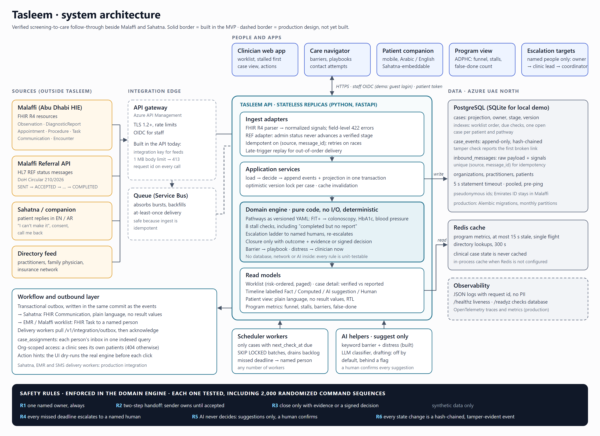
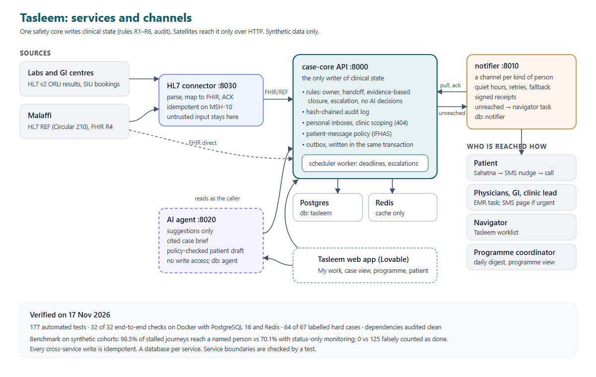
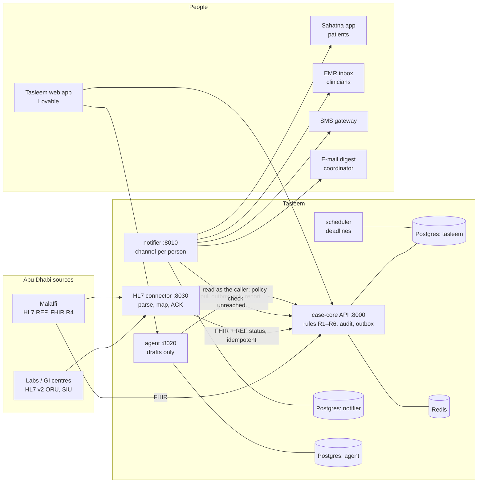
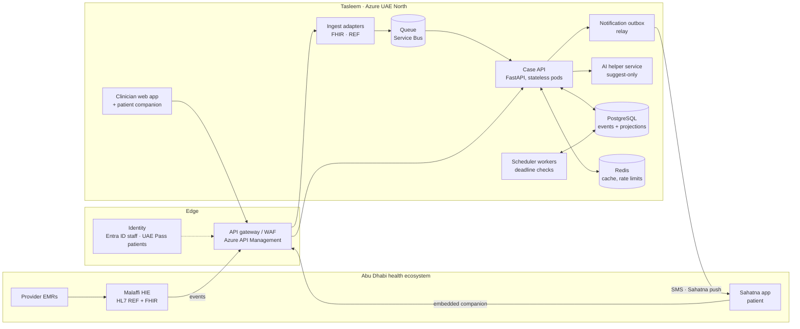
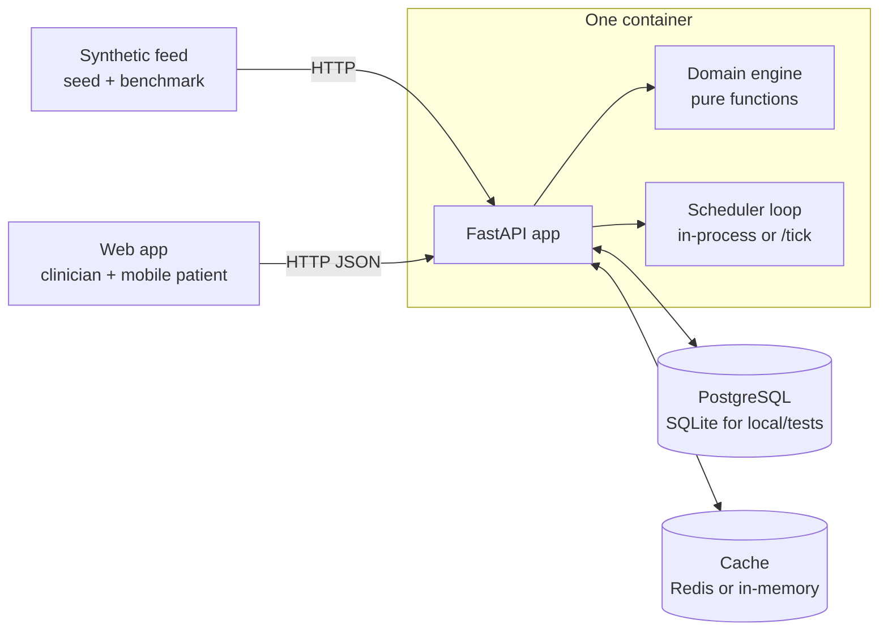

# Tasleem — System architecture

Audience: engineering. Product context: [PRD](../product/PRD.md). Constraints: [Additional.md](../../Additional.md).

Design goals, in priority order:
1. **Safety rules are provable.** R1–R6 live in one pure, side-effect-free domain module that can be tested exhaustively.
2. **Integrate, don't replace.** Malaffi is the source of referral and result events; Sahatna hosts the patient view.
3. **Scale horizontally without redesign.** Stateless API, per-case event streams, database-backed scheduler with row locking, cache in front of read-heavy aggregates.
4. **Split only where failure, scale or trust differ.** One safety core owns clinical state; the notifier, agent, HL7 connector and scheduler are separate services (see section 0 and [ADR-001](ADR-001-service-boundaries.md)).



Image: [architecture.png](architecture.png) · editable source: [architecture.svg](architecture.svg).

---

## 0. Services (v0.2, 17 Nov 2026)



Image: [services.png](services.png) · source: [services.svg](services.svg). The decision and the alternatives that were rejected are in [ADR-001](ADR-001-service-boundaries.md). In short: one **safety core** that alone writes clinical state, plus satellite services that each own one concern and reach the core only over HTTP.



| Service | Port | Command | Database | Health |
|---|---|---|---|---|
| case-core API | 8000 | `uvicorn tasleem.api.app:app` | `tasleem` (Alembic migrations) | `/healthz`, `/readyz` |
| scheduler | — | `python -m tasleem.workers.scheduler` | `tasleem` (same; it is part of the core) | process |
| migrations (one-shot) | — | `python -m tasleem.migrate` | `tasleem` | exit code |
| notifier | 8010 | `uvicorn tasleem_notifier.app:app` | `notifier` | `/healthz`, `/readyz` |
| agent | 8020 | `uvicorn tasleem_agent.app:app` | `agent` | `/healthz`, `/readyz` |
| HL7 connector | 8030 | `uvicorn tasleem_connector.app:app` | none | `/healthz` |

### 0.1 Who authenticates how

| Caller | To | Credential | What it may do |
|---|---|---|---|
| Staff, patients (UI) | case-core, agent | Demo: `X-Demo-User`. Production: OIDC bearer (Entra ID for staff, UAE Pass for patients), validated at the gateway | What their role and clinic allow; anything else returns 404 |
| HL7 connector | case-core | `X-Integration-Key` named `connector` | `ingest` scope only |
| notifier | case-core | `X-Integration-Key` named `notifier` | `outbox` scope only: pull, ack, report unreached |
| agent | case-core | **the caller's own identity, forwarded** | Exactly what the caller can read. No write to cases at all |
| Facilities, interface engine | connector | `X-Connector-Key` | Send HL7 v2 |
| Delivery bridges | notifier | HMAC-SHA256 `X-Tasleem-Signature` on receipts | Report delivered, read or failed |
| Operations | notifier | `X-Ops-Key` | Delivery trail, run a cycle |

Keys are compared in constant time. A key for one scope gets 403 on another. Outside demo mode every service refuses to start without its keys.

### 0.2 Channels per kind of person (notifier policy, `tasleem_notifier/channels.yaml`)

| Person | Routine | Urgent (distress) | If nothing gets through |
|---|---|---|---|
| Patient | Sahatna message → after 24 h unread, content-free SMS nudge. Held during quiet hours (21:00–08:00 Gulf time) | — (patients are never sent clinical urgency by text) | case-core opens a navigator task: "Call the patient" |
| Family physician, clinic lead, GI specialist | FHIR Task in the EMR inbox they already use | EMR task **and** SMS page ("urgent task in your inbox", no case content) at the same time | Operations alert (delivery trail) |
| Care navigator | Tasleem worklist (their work tool) | Worklist + SMS page | — |
| Programme coordinator | One daily e-mail digest at 07:00 | E-mail + SMS page | — |

### 0.3 Data owned by the new services (ER, text form)

```
notifier database
  notifications (outbox_id PK = case-core outbox id, case_id, recipient_id, recipient_role, template,
                 urgent, language, payload JSON, status, step, attempts, next_at, report_pending,
                 received_at, updated_at)                      index (status, next_at)
     1 ──< deliveries (id PK, outbox_id FK, step, channel, status, provider_ref, detail, created_at,
                       updated_at)                              unique (outbox_id, step, channel)
  digest_runs (recipient_id, day) PK, items, sent_at           one digest per person per local day

agent database
  agent_drafts (id PK, case_id, kind brief|outreach, requested_by, source template|extractive|llm,
                model, content JSON, created_at)                append-only; index case_id

case-core additions
  outbox.recipient_role                                         migration 0002
  events PATIENT_MESSAGE_SENT (actor = person, ai_draft_id), DELIVERY_FAILED (actor = integration)
```

### 0.4 New case-core endpoints

| Method and path | Who | What |
|---|---|---|
| `POST /v1/cases/{id}/patient-messages` | staff on the case | Send a plain-language message to Sahatna. Refused with `IFHAS_MESSAGE_POLICY` if it carries a result value, a diagnosis word, advice or a link |
| `POST /v1/policy/patient-message-check` | staff | The same check without sending (the agent calls it on every draft) |
| `GET/POST /v1/me/cases/{id}/prep-check` | the patient | Bowel-preparation teach-back. Answers are never sent to the client; a wrong answer opens a barrier |
| `GET /v1/program/metrics?pathway&org&language` | staff | Programme view filtered by provider and language |
| `GET /v1/program/usage?month=YYYY-MM` | coordinator | Active cases per provider and pathway (SaaS metering) |
| `POST /v1/integration/delivery-failures` | notifier key | Patient not reached on any channel → navigator task (idempotent) |
| `POST /v1/demo/scenarios/unreachable-patient` | demo | A patient with no app and no working phone |

Agent, notifier and connector endpoints are listed in each service's module docstring and in its own `/docs`.

---

## 1. System architecture

### 1.1 Production target



### 1.2 MVP (what ships on 20 Nov)



What changes from MVP to production, without domain changes:

| Concern | MVP | Production |
|---|---|---|
| Ingest | Synchronous HTTP | Queue (Service Bus); same adapter code consumes messages |
| Scheduler | `/v1/system/tick` or in-process loop | N worker replicas; `SELECT … FOR UPDATE SKIP LOCKED` on `next_check_at` (already in the query) |
| Notifications | Events only | Transactional outbox table → relay → SMS / Sahatna push |
| Auth | Demo identity header (guest mode) | OIDC JWT validated at gateway and API |
| Cache | In-memory | Redis (same interface) |
| DB | SQLite locally, Postgres in Docker | Azure Database for PostgreSQL Flexible Server, read replica for program view |

## 2. Component structure

```
backend/
  pathways/                    # clinician-approved pathway configs (YAML, versioned)
    fit-positive.yaml
    hba1c-diabetes.yaml
  tasleem/
    config.py                  # settings from environment
    domain/                    # PURE. No I/O, no clock, no DB. Fully unit-testable.
      model.py                 #   enums, value objects, CaseState, Event
      pathways.py              #   pathway schema + loader
      engine.py                #   commands → events; apply(event) → state; rules R1–R5
      checks.py                #   deterministic stall detection + next deadline
      barriers.py              #   barrier classifier interface, keyword classifier, distress rules
      audit.py                 #   hash chain (R6)
      errors.py                #   DomainError with rule ids
    infra/
      db.py                    # SQLAlchemy models, engine/session
      repository.py            # load/save case aggregate, optimistic locking, event append
      cache.py                 # Cache protocol; InMemoryTTLCache; RedisCache
    services/
      cases.py                 # application service: load → decide → append → project → invalidate cache
      ingest.py                # FHIR/REF → normalized signals → case commands; idempotency
      scheduler.py             # due-case scan and tick
      metrics.py               # program metrics (cached)
      directory.py             # patients, practitioners, orgs, insurance-network routing
    api/
      app.py                   # FastAPI factory, middleware, error mapping
      deps.py                  # DB session, current actor
      schemas.py               # request/response models
      routes_*.py              # routers per area
    seed.py                    # synthetic directory + scenario cases
  tests/
```

**Dependency rule:** `api → services → domain` and `services → infra`. `domain` imports nothing from the other layers. This keeps the safety logic portable (it could run inside Malaffi's own stack) and testable.

## 3. Data flow

### 3.1 Write path (one event, e.g. Malaffi says referral "completed")

```mermaid
sequenceDiagram
  participant M as Malaffi / feed
  participant I as Ingest adapter
  participant S as Case service
  participant D as Domain engine
  participant DB as PostgreSQL
  participant C as Cache
  M->>I: REF status=COMPLETED (message_id)
  I->>DB: insert inbound_message (unique source+message_id)
  alt duplicate
    I-->>M: 200, original result
  end
  I->>S: Signal(admin_status=COMPLETED, patient, pathway)
  S->>DB: load case (state_json, version)
  S->>D: decide(state, command, now)
  D-->>S: [ADMIN_STATUS_CHANGED, STALL_FLAGGED(CLOSED_WITHOUT_EVIDENCE), ESCALATED(to owner)]
  S->>D: apply events → new state, next_check_at
  S->>DB: BEGIN; append events (hash chain); UPDATE case WHERE version=v; COMMIT
  S->>C: bump metrics version (invalidate)
  S-->>I: result
```

Every write is one transaction: events and projection together. For API commands, a failed version check makes the service reload and retry (max 3), then return 409 `CONCURRENT_UPDATE`. Ingest does not retry internally: the whole message rolls back and is redelivered (safe, because ingest is idempotent per message id).

Pathway files declare which signals reach each stage with the key `signals:` (not `on:`, which YAML parses as a boolean).

### 3.2 Deadline path
Each case stores `next_check_at` (the earliest deadline among its pending checks). The scheduler selects due open cases in batches with `FOR UPDATE SKIP LOCKED` (Postgres), runs `checks.evaluate(state, pathway, now)`, appends any stall and escalation events, and recomputes `next_check_at`. Work is proportional to due cases, not to all cases.

### 3.3 Read paths
- Worklist and case detail: indexed projection columns plus `state_json`. No event replay on read.
- Program metrics: aggregate query, cached under a key that includes a global write version; any write bumps the version, so stale data is never served after a write.
- Audit: stream events for one case ordered by `seq`, recompute hashes.

## 4. API design

REST + JSON, versioned under `/v1`. Errors use one envelope: `{"error": {"code": "R3_EVIDENCE_REQUIRED", "message": "...", "details": {...}}}`. Rule violations return **409**, validation **422**, missing **404**, optimistic-lock conflict **409 `CONCURRENT_UPDATE`**.

Identity: production uses `Authorization: Bearer <OIDC JWT>`. Demo mode (`TASLEEM_DEMO_MODE=true`) accepts `X-Demo-User: <practitioner id | patient id>` so reviewers can "Continue as Guest". The `ai`, `system` and `integration` actor types can never be claimed by a caller.

| Method | Path | Purpose | Who |
|---|---|---|---|
| GET | `/healthz` | Liveness and DB check | any |
| POST | `/v1/ingest/fhir` | Ingest one FHIR resource or Bundle | integration |
| POST | `/v1/ingest/referral-status` | Ingest Malaffi REF status | integration |
| GET | `/v1/cases` | Worklist. Query: `owner`, `status`, `stalled`, `pathway`, `limit`, `cursor` | staff |
| GET | `/v1/cases/{id}` | Detail: reported vs verified progress, stalls, barriers, owner, timeline | staff |
| POST | `/v1/cases/{id}/handoff` | Offer `{to, reason}` | owner, coordinator |
| POST | `/v1/cases/{id}/handoff/accept` | Accept | handoff target |
| POST | `/v1/cases/{id}/handoff/reject` | Reject `{reason_code}` | handoff target |
| POST | `/v1/cases/{id}/barriers` | Report `{codes[], text?}` | patient, staff |
| POST | `/v1/cases/{id}/barriers/{bid}/confirm` | Confirm `{code}` | staff |
| POST | `/v1/cases/{id}/barriers/{bid}/resolve` | Resolve `{note}` | staff |
| POST | `/v1/cases/{id}/distress/resolve` | Clinician clears distress `{note}` | clinician |
| POST | `/v1/cases/{id}/contact-attempts` | Log `{channel, result}` | staff |
| POST | `/v1/cases/{id}/consults` | Ask specialist `{to, question}` | owner |
| POST | `/v1/cases/{id}/consults/{cid}/answer` | Answer `{answer}` | consult target |
| POST | `/v1/cases/{id}/close` | Close `{outcome, evidence_ref?, reason?}` | per FR-6 |
| GET | `/v1/cases/{id}/referral-options` | In-network providers for the pathway service | staff |
| GET | `/v1/cases/{id}/audit` | Events + chain verification | staff |
| GET | `/v1/me/cases` | Patient companion view (no result values) | patient |
| GET | `/v1/program/metrics` | Funnel, stalls, barriers, outcomes, false-done | coordinator |
| GET | `/v1/directory/people` | Demo personas for guest login | any (demo) |
| POST | `/v1/system/tick` | Run due deadline checks `{now?}` | system / demo |
| POST | `/v1/admin/reset-demo` | Reseed demo data | demo mode only |
| GET | `/v1/me` | Who am I (role, org, whether the person sees all cases) | any persona |
| GET | `/v1/me/work` | Personal inbox grouped by why: distress, escalated, handoff, consult, task, owner | staff |
| GET | `/v1/cases/{id}/notifications` | Messages queued or sent for this case | staff |
| GET | `/v1/integration/outbox` | Pull pending outbound messages (`after_id`, `limit`) | integration |
| POST | `/v1/integration/outbox/ack` | Mark delivered `{ids[]}` | integration |
| GET | `/v1/demo/scenarios` | Malaffi feed simulator list | demo mode only |
| POST | `/v1/demo/scenarios/{id}` | Play a scenario through the real ingest path | demo mode only |

Case detail also returns `next_step` (one deterministic next action with a named person) and `actions` (every command dry-run against the engine for the viewer, with the rule code when it is refused). Every case endpoint is **org-scoped**: a clinic sees its own patients, people pulled into a case by an escalation, handoff or consult see that case, the programme coordinator sees all; anything else is `404`.

Pagination: keyset cursor on `(updated_at, id)`.
Idempotency: ingest uses the message id; command endpoints accept an `Idempotency-Key` header (stored with the event; production item).

## 5. Database schema

PostgreSQL (SQLite-compatible subset for local and tests). JSON columns are `JSONB` in Postgres.

```sql
CREATE TABLE organizations (
  id               TEXT PRIMARY KEY,
  name             TEXT NOT NULL,
  kind             TEXT NOT NULL,              -- primary_care | gi_centre | lab | program
  services         JSONB NOT NULL DEFAULT '[]',-- e.g. ["colonoscopy"]
  insurance_networks JSONB NOT NULL DEFAULT '[]'
);

CREATE TABLE practitioners (
  id      TEXT PRIMARY KEY,
  name    TEXT NOT NULL,
  role    TEXT NOT NULL,   -- family_physician | gi_specialist | navigator | clinic_lead | program_coordinator
  org_id  TEXT NOT NULL REFERENCES organizations(id),
  lead_id TEXT REFERENCES practitioners(id)   -- escalation level 2
);

CREATE TABLE patients (                       -- pseudonymous; no national ID stored
  id                   TEXT PRIMARY KEY,
  display_name         TEXT NOT NULL,         -- synthetic in demo
  preferred_language   TEXT NOT NULL DEFAULT 'en',
  insurance_network    TEXT,
  family_physician_id  TEXT REFERENCES practitioners(id),
  birth_year           INT,
  consent_at           TIMESTAMPTZ
);

CREATE TABLE cases (                          -- read projection of the event stream
  id             TEXT PRIMARY KEY,
  patient_id     TEXT NOT NULL REFERENCES patients(id),
  pathway_id     TEXT NOT NULL,
  pathway_version INT NOT NULL,
  status         TEXT NOT NULL,               -- open | closed
  owner_id       TEXT NOT NULL,               -- R1: never null
  verified_stage TEXT NOT NULL,
  admin_status   TEXT NOT NULL,
  priority       TEXT NOT NULL,
  open_stall_count INT NOT NULL DEFAULT 0,
  escalation_level INT NOT NULL DEFAULT 0,
  outcome        TEXT,
  opened_at      TIMESTAMPTZ NOT NULL,
  updated_at     TIMESTAMPTZ NOT NULL,
  last_progress_at TIMESTAMPTZ NOT NULL,      -- latest verified evidence; drives "days since progress"
  closed_at      TIMESTAMPTZ,
  next_check_at  TIMESTAMPTZ,
  last_hash      TEXT NOT NULL,               -- head of the case's hash chain
  state_json     JSONB NOT NULL,
  version        INT NOT NULL                 -- optimistic lock
);
CREATE INDEX ix_cases_owner_status   ON cases (owner_id, status);
CREATE INDEX ix_cases_status_stalled ON cases (status, open_stall_count);
CREATE INDEX ix_cases_due            ON cases (next_check_at) WHERE status = 'open';
CREATE UNIQUE INDEX ux_cases_open_per_pathway ON cases (patient_id, pathway_id) WHERE status = 'open';

CREATE TABLE case_events (                    -- append-only, hash-chained per case (R6)
  id          BIGSERIAL PRIMARY KEY,
  case_id     TEXT NOT NULL REFERENCES cases(id),
  seq         INT  NOT NULL,
  type        TEXT NOT NULL,
  actor_id    TEXT NOT NULL,
  actor_type  TEXT NOT NULL,                  -- clinician | navigator | coordinator | patient | system | ai | integration
  occurred_at TIMESTAMPTZ NOT NULL,
  recorded_at TIMESTAMPTZ NOT NULL,
  payload     JSONB NOT NULL,
  prev_hash   TEXT NOT NULL,
  hash        TEXT NOT NULL,
  UNIQUE (case_id, seq)
);

CREATE TABLE inbound_messages (               -- idempotency + unmatched store
  id          BIGSERIAL PRIMARY KEY,
  source      TEXT NOT NULL,
  message_id  TEXT NOT NULL,
  kind        TEXT NOT NULL,
  payload     JSONB NOT NULL,
  result      JSONB,
  status      TEXT NOT NULL,                  -- applied | unmatched | ignored | error
  received_at TIMESTAMPTZ NOT NULL,
  UNIQUE (source, message_id)
);
```

Production additions: `outbox` (notifications), partitioning `case_events` by month at > 100M rows, row-level security per organization, revoke `UPDATE`/`DELETE` on `case_events` from the app role.

## 6. Caching strategy

| Data | Where | Key | TTL | Invalidation |
|---|---|---|---|---|
| Pathway configs | Process memory | pathway id + version | Process lifetime | Immutable per version; new version = new key |
| Directory lookups (practitioner, org) | Cache | `dir:{kind}:{id}` | 300 s | Low churn; reseed clears |
| Program metrics | Cache | `metrics:{filters}` → `{write_version, computed_at, data}` | 60 s | Exact when `write_version` matches. After a write, a result younger than `metrics_max_staleness_seconds` (15 s) is served and flagged `stale: true`, so a busy ingest stream cannot force a full scan per dashboard read. One recompute per key per process at a time (single flight). The scan streams state documents in batches in one pass |
| Worklist, case detail | Not cached | — | — | Served from indexed projection; correctness beats latency for clinical state |
| Ingest idempotency | Database unique key | `(source, message_id)` | Permanent | — (Redis can front it at very high volume) |

Rationale: clinical case state is never cached, because a stale "not stalled" view is a safety risk. Only aggregates and static reference data are cached.

## 6.1 Workflow layer (added 16 Nov)

- **`case_assignments`** (projection, rebuilt in the same transaction as every case write): one row per (case, person, kind, ref) for owner, escalation target, handoff receiver, consultee, distress clinician and barrier assignee. Drives `/v1/me/work` and org-scoped visibility with one indexed query (`ix_assign_person`), not a scan.
- **`outbox`** (transactional outbox): rows written in the same commit as the events that caused them. EMR/Malaffi worklist messages are FHIR `Task` (owner, priority, description = next step); patient messages are FHIR `Communication` in the patient's language with no values or codes. Delivery workers pull in id order and acknowledge; at-least-once delivery, so receivers dedupe on `id`.
- **`domain/actions.py`**: the UI's enabled/disabled buttons come from dry-running the real command functions, so the UI and the engine can never disagree.
- **`demo.py`**: live scenarios for the simulator; they only send the messages a lab, hospital or patient would send.
- **Pathway C** (`pathways/hypertension.yaml`): raised screening blood pressure, configuration only.

## 7. Scalability and reliability

- **Stateless API**: horizontal pods behind the gateway; sessions in tokens.
- **Contention**: optimistic locking per case; events keyed `(case_id, seq)`, so different cases never contend.
- **Scheduler**: index on `next_check_at`, batch claim with `SKIP LOCKED`, any number of workers. Each run drains in batches (`scheduler_batch_size`, default 500) until nothing is due or the time budget (30 s) is spent, so a backlog after an outage clears in one run, not one batch per interval.
- **Ingest bursts**: queue absorbs spikes; adapters are idempotent, so at-least-once delivery is safe.
- **Read scaling**: worklist ordered by a composite index `(status, open_stall_count, escalation_level, last_progress_at)` with `limit` + `offset` paging (`next_offset` in the response); program view can read from a replica; metrics cached with bounded staleness.
- **Data growth**: ~7–20 events per case. At 200k actionable results a year that's ~4M events a year, comfortably one Postgres instance; partition later.
- **Guards**: request bodies over 1 MB rejected with 413 before parsing; Postgres `statement_timeout` 5 s per statement; connection pool with pre-ping and recycle; SQLite runs in WAL mode so demo readers never block the writer.
- **Health**: `/healthz` is liveness only (no DB call, so a DB blip does not restart pods); `/readyz` checks the database and takes the pod out of rotation when it fails.

### 7.1 Failure modes the code handles (each has a test)

| Failure | What happens | Test |
|---|---|---|
| Same message delivered twice at the same moment to two workers | Unique `(source, message_id)` trips on flush, the whole transaction rolls back, the retry sees the stored message and returns `duplicate: true`. No evidence applied twice | `test_robustness::test_duplicate_message_racing_another_worker_is_not_applied_twice` |
| Two different trigger results for one patient arrive at once | Partial unique index allows one open case per patient and pathway; the loser retries and attaches to the winner's case | covered by the same retry path (`IngestService._process`) |
| Staff command and ingest change one case at once | Version check fails for one; commands retry up to 3 times, ingest up to 4; otherwise 409 `CONCURRENT_UPDATE`, never a lost update | `test_api` I5, `test_robustness` |
| Scheduler offline for days | Next run drains every due case in batches within its budget | `test_robustness::test_scheduler_drains_a_backlog_in_batches` |
| Two scheduler workers overlap | `SKIP LOCKED` claim on Postgres; any overlap becomes a counted conflict, never a double escalation | `scheduler.tick` conflict counter |
| Dashboard hammered during bulk ingest | Metrics served from cache within the 15 s bound, flagged stale | `test_robustness::test_metrics_staleness_is_bounded_and_flagged` |
| Oversized or malformed payload | 413 before parsing; 422 with the field name for invalid FHIR | `test_robustness`, `test_api` I3 |
| Database unreachable | `/readyz` fails, the load balancer stops routing; liveness stays up | `test_robustness::test_readiness_and_liveness_are_separate` |
| AI helper down | Barrier stays unclassified and goes to the human queue (fail safe, never fail open) | design rule R5 |

### 7.2 Measured on a laptop

`python -m tasleem.loadtest --patients 5000` pushes 29,099 synthetic messages through the real ingest path. Results in [docs/evidence/SCALE.md](../evidence/SCALE.md): ~235 messages/s on one process with SQLite, flat from 300 to 5,000 patients; worklist page p95 about 20 ms; case detail p95 about 1 ms; cold metrics scan about 0.24 s; 0 broken audit chains; 0 open cases without an owner.

## 8. Security, privacy and compliance

- Pseudonymous patient IDs inside Tasleem; the Emirates ID mapping stays in Malaffi.
- Minimum data: no result values are needed in the patient view; observation values are stored only as evidence references.
- Consent captured as an event; patient view requires consent.
- Least privilege by role; patients see only their own cases.
- Audit log is append-only and hash-chained; verification endpoint.
- Production: UAE data residency (Azure UAE North), TLS 1.2+, encryption at rest, secrets in Key Vault, DoH and ADHICS controls review.

## 9. Observability
Structured JSON logs with request id; no PII in logs (IDs only). `/healthz` for liveness, `/readyz` for readiness (checks the DB). OpenTelemetry instrumentation can be enabled through environment configuration. Domain metrics (stalls flagged, escalations, closures blocked by rule) are emitted as events and counted by the metrics service.

## 10. Deployment
- Local: `pip install -e backend[dev]`, `uvicorn tasleem.api.app:app --reload` (SQLite).
- Docker: `docker compose up --build` (API + Postgres + Redis).
- Cloud (MVP): one container on Azure Container Apps (or any container host) + managed Postgres; frontend as static files on the same host or a static web app.
