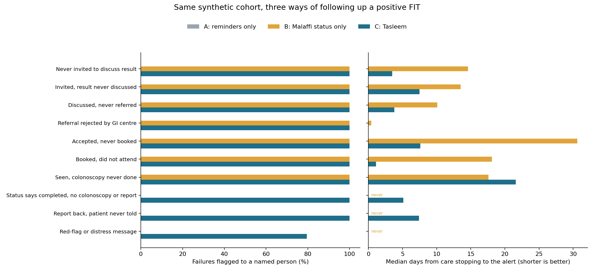

# Three-arm benchmark

Run: `python -m tasleem.bench --n 1000 --seeds 2026,2027,2028`. Synthetic cohort of 1,000 people with a positive FIT per seed, 11,516 delivered messages (seed 2026). Numbers are seed 2026; brackets give the range across all 3 seeds.

**What it measures:** when care stops, does a named person find out, how fast, and is "done" really done.
**What it does not measure:** whether patients then get care. That needs a clinical pilot.

## Arms (same messages, same timing, same noise)
| Arm | What it sees | What it does |
|---|---|---|
| A Reminders only | Appointment bookings | Reminds the patient 2 days before. Raises no staff alerts (status quo) |
| B Malaffi status only | FIT results and referral statuses (SENT, ACCEPTED, SCHEDULED, COMPLETED, CANCELLED) | Daily rules, deliberately generous: no referral 14 days after FIT; referral cancelled; status unchanged 30 days. COMPLETED = done |
| C Tasleem | The same feed plus clinical evidence (encounters, appointments, procedures, reports, communications) and patient replies | The real engine, real ingest path, daily scheduler |

## Headline
| Measure | A: reminders only | B: Malaffi status only | C: Tasleem |
|---|---|---|---|
| Failures flagged to a named person | 0.0% | 70.1% (70.1–74.1) | 98.5% (98.5–99.5) |
| Median days from care stopping to alert | — | 14.4 (14.3–14.4) | 4.0 |
| 90th percentile days to alert | — | 30.3 (30.2–30.3) | 8.0 (8.0–21.0) |
| Counted as done | — | 528 (509–528) | 403 (389–403) |
| …of which care was not complete (false done) | — | 125 (113–135) | 0 |
| Clean journeys that got a false alert | 0.0% | 0.0% | 0.0% (0.0–0.2) |
| Staff alerts per 100 patients | 0.0 | 38.5 (38.5–40.6) | 66.4 (66.4–72.1) |
| Distress messages reaching a clinician within 24 h | 0.0% | 0.0% | 79.5% (79.5–89.7) |

Truly complete journeys (report received and patient told): 403.

Distress: the cohort draws from 8 messages; 7 contain a cue word and 1 ("My stomach hurts so much I can barely stand") deliberately does not. Every miss in the distress row is that message. Cue-bearing messages reached a clinician the same day in every case. The keyword detector is frozen for this run; the fix belongs in a new version tested on new, unseen messages, not in tuning to this set.

## By failure type (detected %, median days to alert)
| Failure (n, seed 2026) | A: reminders only | B: Malaffi status only | C: Tasleem | Tasleem gave the right reason |
|---|---|---|---|---|
| Never invited to discuss result (41) | 0.0%, — d | 100.0%, 14.6 d | 100.0%, 3.5 d | 100.0% |
| Invited, result never discussed (52) | 0.0%, — d | 100.0%, 13.5 d | 100.0%, 7.5 d | 100.0% |
| Discussed, never referred (36) | 0.0%, — d | 100.0%, 10.1 d | 100.0%, 3.8 d | 100.0% |
| Referral rejected by GI centre (51) | 0.0%, — d | 100.0%, 0.4 d | 100.0%, 0.0 d | 100.0% |
| Accepted, never booked (54) | 0.0%, — d | 100.0%, 30.6 d | 100.0%, 7.6 d | 100.0% |
| Booked, did not attend (105) | 0.0%, — d | 100.0%, 18.1 d | 100.0%, 1.1 d | 100.0% |
| Seen, colonoscopy never done (46) | 0.0%, — d | 100.0%, 17.6 d | 100.0%, 21.6 d | 100.0% |
| Status says completed, no colonoscopy or report (71) | 0.0%, — d | 0.0%, — d | 100.0%, 5.1 d | 100.0% |
| Report back, patient never told (54) | 0.0%, — d | 0.0%, — d | 100.0%, 7.4 d | 100.0% |
| Red-flag or distress message (must reach a clinician in 24 h) (39) | 0.0%, — d | 0.0%, — d | 79.5%, 0.0 d | 79.5% |

## Tasleem-only checks
| Check | Result |
|---|---|
| Barrier suggestion for patient replies after a missed appointment (n = 65) | 52 right, 0 wrong, 13 no suggestion. Every reply is shown to a human, who confirms the code (R5) |
| Patients with no family physician still given a named owner | 17 of 17 |
| Open cases without an owner (R1) | 0 |
| Messages that crashed ingest | 0 |

## How the cohort is built (tasleem/bench/cohort.py)
- One scenario per person, drawn with fixed weights so every failure type is well represented. **The weights are not prevalence estimates**; read the per-failure table, not only the headline.
- Steps that happen are timed with random delays inside the pathway deadlines.
- Delivery noise for every arm: 10% of messages delivered twice, 5% delivered up to 36 h late. 3% of people have no family physician.
- Ground truth is written before any arm runs. Latency is measured from the moment care actually stopped (the last real event, missed appointment, rejection or message), not from any arm's own deadline.
- Half the no-shows have an explicit no-show record; half are silent. 60% of no-shows send a free-text reason (some deliberately without the classifier's cue words). One distress text has no cue words by design.

## Limits, stated plainly
- Synthetic data, written by the team. It shows the logic catches what it is designed to catch; it cannot show real-world prevalence or effect on outcomes.
- Arm B's rules are our reconstruction of a sensible status-only monitor. A real deployment might use other thresholds; we picked generous ones.
- Tasleem's deadlines are placeholders until the screening programme's clinical lead sets them, and its detection delay depends on them.
- Tasleem sees more data than B. That is the point being tested: verified clinical evidence versus administrative status.

Runtime (seed 1): A: reminders only 0.0 s, B: Malaffi status only 0.1 s, C: Tasleem 92.8 s.
Per-case results for seed 1: [benchmark_cases.csv](benchmark_cases.csv).
